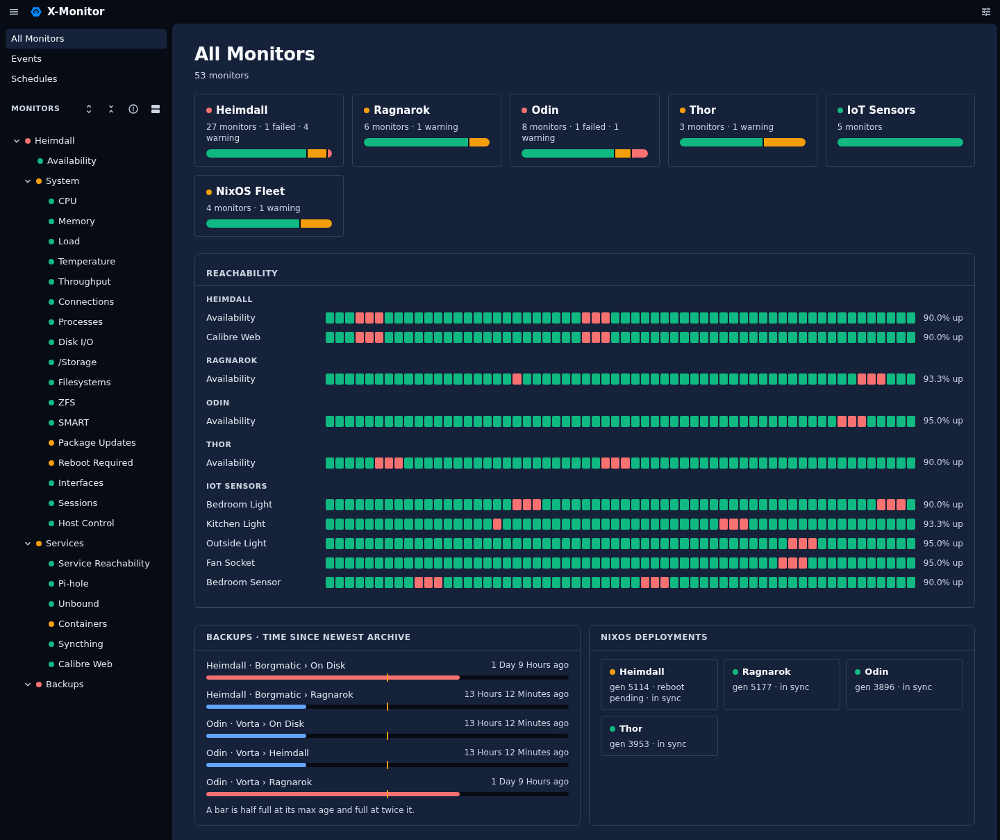

# X-Monitor

[](https://x-tech-laboratories.github.io/guidelines/readiness/)

<a href="https://liberapay.com/BeatLink/donate"></a> <a href="https://ko-fi.com/I4V52ANK6N"></a>

X-Monitor is a web-based network and systems monitor for Linux hosts, homelabs and small networks, inspired by Uptime Kuma, Prometheus, Grafana and Loki. One dashboard watches your machines, services and devices, and can act on them too: restart a service, reboot a host, wake it over the network.



## Features

- **Agent or agentless**: run the small X-Monitor agent on hosts you control for live events, or reach any host over SSH, HTTP, DNS and ICMP. Every monitor works either way.
- **Live dashboard**: status, latency history, charts and logs, in a light and a dark theme.
- **Log search**: search the systemd journal of every host at once by time, priority, unit and text, and group the results by host, unit or priority.
- **Notifications**: to the desktop, ntfy, email, webhooks or about a hundred services through Apprise, when a monitor fails, keeps failing or recovers.
- **Actions**: restart services, run your own commands, and reboot, suspend or wake hosts, each confirmed and logged.
- **Groups and links**: nest monitors by host, service or location, and show one monitor in several groups at once.
- **Plugins**: each monitor type is a small TypeScript plugin, and you can add your own as a plugin folder.
- **Exports**: Prometheus, InfluxDB, and MQTT with Home Assistant discovery.

## Quick start

You need Node 24 or newer, and SSH access to the hosts you want to watch (or the agent installed on them).

```bash
npm ci
npm run build
npm start -- --config config.yaml
```

Then open <http://localhost:8080>. `config.example.json` is a working config that watches this machine; the config
may be YAML or JSON. A minimal `config.yaml`:

```yaml
database:
  path: "x-monitor.db"

plugins:
  - name: "Home"
    type: "group"
    children:
      - name: "Router"
        type: "uptime"
        target_host: "192.168.1.1"
      - name: "Nginx"
        type: "systemd_service"
        service_name: "nginx.service"
        ssh_config:
          host: "web-01.example.com"
          user: "x-monitor"
```

With Nix, `nix run . -- --config config.yaml` runs it, `nix develop` opens a dev shell, and the flake's NixOS modules run the server (`services.x-monitor`) and the agent (`services.x-monitor-agent`). To look around without any hosts, `dev/demo/run.sh --sample` starts the dashboard on a made-up fleet.

## Accounts, API and backups

- **Sign in**: the users in the accounts file named by `X_MONITOR_PASSWORD_HASH_FILE` (written by `npm run hash-password`) and the one in config's `auth.username` and `auth.password` are admins, who add viewers and operators on the Users page. Single sign-on comes from `X_MONITOR_OIDC_*`. With no user anywhere, the dashboard stays open as before.
- **API**: every call the page makes is served at `/api/call/<name>`, described at `/api/openapi.json` and offered as MCP tools at `/api/mcp`, beside the REST routes scripts already use. A script sends a token made on Your account, or one declared in `auth.tokens` (`x-monitor token new`).
- **Backups**: the state database is backed up daily beside it in `backups/`, at `/api/state-backups` and on the Settings page. History of edits is left out: the database is a log of readings and events that are never edited, so there are no versions to keep.

## Development

The app is TypeScript on Node 24: a Fastify server (`src/server`), a React page bundled by Vite (`src/web`), the agent
(`src/agent`), and between them the engine (`src/core`) and the monitor types (`src/monitors`), which the server and the
agent both run, and `src/shared` for what the page may import too.

```bash
npm run dev:server   # the server against config.example.json, restarting on changes
npm run dev:web      # the page with hot reload, calling the dev server
npm test             # vitest
npm run lint         # oxlint
```

`dev/demo/run.sh --sample` runs the dashboard on sample readings and `dev/demo/shoot.sh` screenshots it; see
[dev/demo/README.md](dev/demo/README.md).

## Where X-Monitor departs from the Application Standard

- **`src/core` and `src/monitors` beside `src/shared`**: the agent runs the engine and the monitors itself when it
  collects without the server, so that code is shared by the server and the agent but uses Node and must stay out of
  the page; `src/shared` keeps only what the page may import.
- **Integer row ids**: the metric, status, event, log and job tables are append-only logs that never sync between
  devices, and they open the database the Python X-Monitor wrote in place, so they keep its integer ids rather than
  ids every device can make.
- **No history of edits**: as above, nothing in the database is ever edited.
- **Folder plugins run with X-Monitor's full rights**: a monitor type loaded from `plugin_paths` is not sandboxed, so
  install only plugins you trust.
- **`dev/demo/shoot.py` is Python**: it is a development helper, not part of the app, and takes Playwright and its
  browsers from nixpkgs with nothing to install through npm.

## Documentation

- [Configuration](docs/configuration.md): the config file, links, sign-in and API tokens, live reload
- [Plugin reference](docs/plugins.md): every monitor type and its options
- [Agent guide](docs/agent.md): installing and using `x-monitor-agent`
- [Notifications](docs/notifications.md): channels and per-monitor rules
- [Integrations](docs/integrations.md): events feed, REST API, Prometheus, InfluxDB, MQTT
- [Theme](docs/theme.md): light and dark schemes, color overrides
- [Architecture](docs/architecture.md) and [development notes](docs/develop.md): how it is built
- [Moving from Vigil](docs/migrating-from-vigil.md): upgrading from X-Monitor's old name
- [Roadmap](docs/roadmap.md)

## Credits

App icon: [Guard Protection Safe 3](https://www.svgrepo.com/svg/421980/guard-protection-safe-3) from [SVG Repo](https://www.svgrepo.com).

## License

GPL-3.0-or-later
