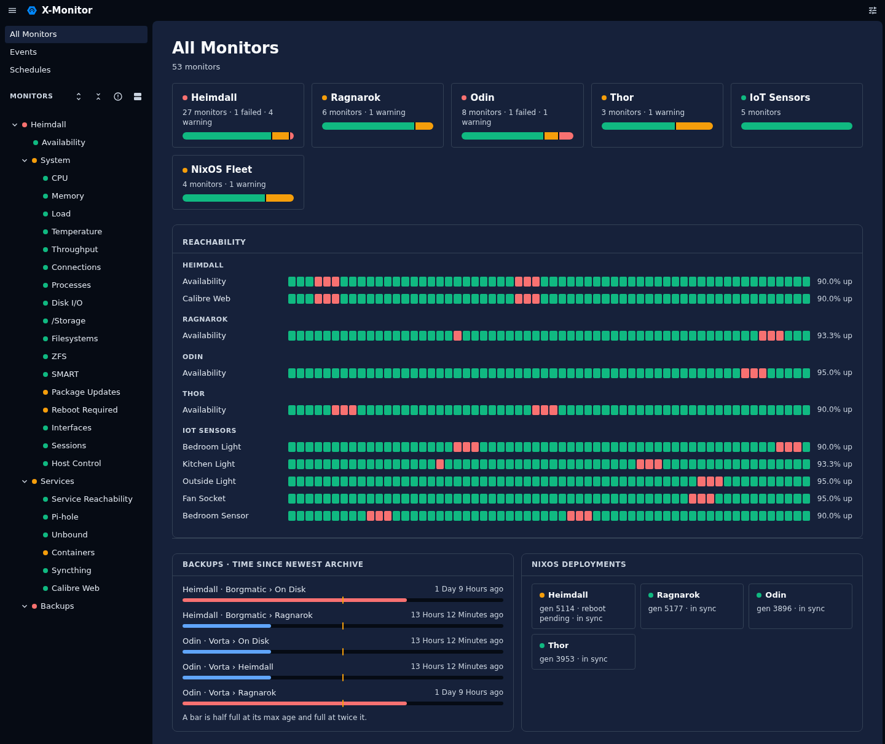

# X-Monitor

[](https://x-tech-laboratories.github.io/guidelines/readiness/)

X-Monitor is a web-based network and systems monitor for Linux hosts, homelabs and small networks, inspired by Uptime Kuma, Prometheus, Grafana and Loki. One dashboard watches your machines, services and devices, and can act on them too: restart a service, reboot a host, wake it over the network.



## Features

- **Agent or agentless**: run the small X-Monitor agent on hosts you control for live events, or reach any host over SSH, HTTP, DNS and ICMP. Every monitor works either way.
- **Live dashboard**: status, latency history, charts and logs, in a light and a dark theme.
- **Notifications**: to the desktop, ntfy, email, webhooks or about a hundred services through Apprise, when a monitor fails, keeps failing or recovers.
- **Actions**: restart services, run your own commands, and reboot, suspend or wake hosts, each confirmed and logged.
- **Groups and links**: nest monitors by host, service or location, and show one monitor in several groups at once.
- **Plugins**: each monitor type is a small Python plugin, and you can add your own.
- **Exports**: Prometheus, InfluxDB, and MQTT with Home Assistant discovery.

## Quick start

You need Python 3.9 or newer, and SSH access to the hosts you want to watch (or the agent installed on them).

```bash
pip install .                # or: pip install '.[apprise,mqtt]' for those extras
x-monitor --config config.yaml
```

Then open <http://localhost:8080>. A minimal `config.yaml`:

```yaml
database:
  path: "x-monitor.db"

plugins:
  - name: "Home"
    type: "group"
    children:
      - name: "Router"
        type: "uptime"
        target_host: "192.168.1.1"
      - name: "Nginx"
        type: "systemd_service"
        service_name: "nginx.service"
        ssh_config:
          host: "web-01.example.com"
          user: "x-monitor"
```

With Nix, `nix run . -- --config config.yaml` runs it and `nix develop` opens a dev shell. To look around without any hosts, `dev/demo/run.sh --sample` starts the dashboard on a made-up fleet.

## Documentation

- [Configuration](docs/configuration.md): the config file, links, sign-in and API tokens, live reload
- [Plugin reference](docs/plugins.md): every monitor type and its options
- [Agent guide](docs/agent.md): installing and using `x-monitor-agent`
- [Notifications](docs/notifications.md): channels and per-monitor rules
- [Integrations](docs/integrations.md): events feed, REST API, Prometheus, InfluxDB, MQTT
- [Theme](docs/theme.md): light and dark schemes, color overrides
- [Architecture](docs/architecture.md) and [development notes](docs/develop.md): how it is built
- [Moving from Vigil](docs/migrating-from-vigil.md): upgrading from X-Monitor's old name
- [Roadmap](docs/roadmap.md)

## Credits

App icon: [Guard Protection Safe 3](https://www.svgrepo.com/svg/421980/guard-protection-safe-3) from [SVG Repo](https://www.svgrepo.com).

## License

GPL 3.0
